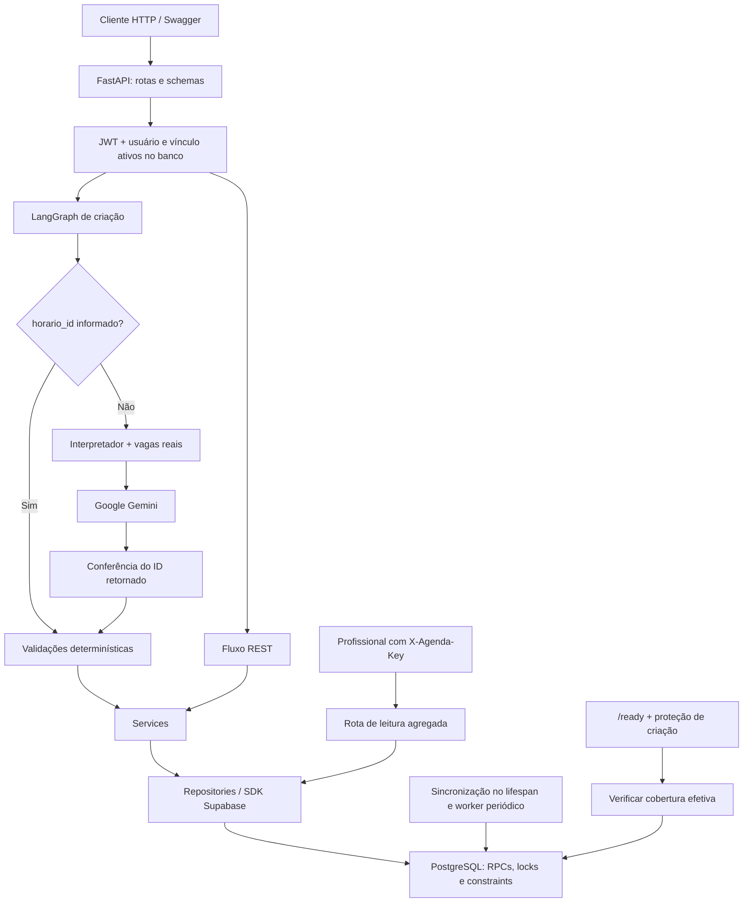

# BB Massoterapia AI

Backend de agendamento de massoterapia corporativa, desenvolvido em Python com FastAPI, Supabase/PostgreSQL e LangGraph integrado ao Google Gemini. Centraliza a oferta de sessões, o acesso individual dos colaboradores e as regras de reserva, mantendo a decisão transacional no banco de dados.

O contexto do projeto é o atendimento institucional a colaboradores. O MVP reduz o cadastro repetitivo de horários e evita conflitos de reservas, sem atribuir um profissional no momento do agendamento. Este repositório contém a API, as migrations, os testes e os guias operacionais; não contém uma interface web para o usuário final.

**Referência desta documentação:** código da `main`, base `7e0883a`, com migrations 001–008. A implementação de cancelamento por linguagem natural está isolada em `feature/langgraph-cancelamento` e **não faz parte da versão descrita aqui**. Os endereços de produção são informados pela equipe; a disponibilidade e a configuração remotas não são certificadas por este documento.

- API publicada: [bb-massoterapia-ai.onrender.com](https://bb-massoterapia-ai.onrender.com).
- Swagger publicado: [documentação interativa](https://bb-massoterapia-ai.onrender.com/docs).
- Versão declarada no FastAPI: `0.3.0`.

## Navegação

- [Escopo e funcionalidades](#escopo-e-funcionalidades)
- [Tecnologias](#tecnologias)
- [Arquitetura](#arquitetura)
- [Estrutura do repositório](#estrutura-do-repositório)
- [Regras de negócio](#regras-de-negócio)
- [Agenda automática](#agenda-automática)
- [API e permissões](#api-e-permissões)
- [Autenticação e segurança](#autenticação-e-segurança)
- [Execução local](#execução-local)
- [Banco de dados e migrations](#banco-de-dados-e-migrations)
- [LangGraph e inteligência artificial](#langgraph-e-inteligência-artificial)
- [Testes e qualidade](#testes-e-qualidade)
- [Deploy e operação](#deploy-e-operação)
- [Limitações e evolução](#limitações-e-evolução)
- [Documentação complementar](#documentação-complementar)

## Escopo e funcionalidades

| Área | Funcionalidade implementada |
| --- | --- |
| Contas | Login JWT, consulta do usuário autenticado e provisionamento administrativo de contas individuais |
| Colaboradores | Cadastro, listagem administrativa e consulta do próprio cadastro |
| Disponibilidades | Geração automática de sessões e consulta de vagas efetivamente disponíveis |
| Reservas | Agendamento por IDs ou por solicitação textual interpretada pelo Gemini |
| Histórico | Consulta de reservas, preservação dos cancelados e atualização administrativa de status |
| Calendário | Feriados nacionais e bloqueios administrativos de datas ou intervalos |
| Profissionais | Cadastro de referência, sem perfil/login; leitura operacional com chave separada |
| Operação | Diagnóstico de processo, conexão com o banco e prontidão da agenda |

Os únicos perfis autenticados são `admin` e `colaborador`. A terceirizada não é um perfil ativo. Na `main`, o cancelamento é feito por administrador em `PATCH /agendamentos/{agendamento_id}/status`; não há rota de cancelamento self-service para colaborador nem cancelamento textual no grafo.

## Tecnologias

| Camada | Tecnologia e finalidade |
| --- | --- |
| API | Python; FastAPI `0.116.1`; Uvicorn `0.35.0`; schemas Pydantic para entradas, respostas e contratos RPC |
| Persistência | PostgreSQL no Supabase; SDK `supabase` 2.x para consultas pela Data API e chamadas RPC |
| IA | LangGraph 1.x para orquestração; `langchain-google-genai` 2.x e `ChatGoogleGenerativeAI` para interpretar pedidos |
| Segurança | PyJWT para JWT; `pwdlib[argon2]` para hash de senhas; `email-validator` para e-mails |
| Calendário | `holidays` para feriados nacionais; `zoneinfo` e `tzdata` para datas locais |
| Configuração | `python-dotenv`, variáveis de ambiente e configurações carregadas por `app/core/config.py` |
| Infraestrutura | Render, com Blueprint em `render.yaml`; Supabase separado do processo da API |
| Qualidade | pytest, HTTPX/TestClient, mocks e psycopg 3 opcional para PostgreSQL local real |

As dependências efetivas estão em [requirements.txt](requirements.txt) e [requirements-postgres-test.txt](requirements-postgres-test.txt). Pydantic é utilizado pelo código e instalado como dependência do FastAPI; não existe pin direto separado no arquivo principal. O runtime declarado no Render é Python `3.12.5`.

## Arquitetura



As rotas autenticam e autorizam o solicitante; os schemas validam o contrato. Services traduzem regras e erros; repositories encapsulam o acesso ao Supabase. A criação e a atualização de status são finalizadas por RPCs transacionais, não por uma sequência de escritas HTTP compensatórias.

O grafo faz pré-validações, mas não substitui as verificações sob locks no PostgreSQL. A leitura dos profissionais usa autenticação por chave, sem usuário JWT, e entrega somente contagens e intervalos.

## Estrutura do repositório

```text
bb-massoterapia-ai/
|-- app/
|   |-- main.py                  # FastAPI, lifespan, CORS, /health e /ready
|   |-- api/router.py            # Routers efetivamente publicados e /health/db
|   |-- api/routes/              # Auth, cadastros, horários, agenda e reservas
|   |-- core/                    # Configuração, JWT, hashes e datas locais
|   |-- schemas/                 # Contratos Pydantic
|   |-- services/                # Provisionamento, reservas e sincronização
|   |-- database/supabase.py     # Cliente servidor Supabase
|   |-- database/repositories/   # Consultas e adaptação dos envelopes RPC
|   |-- graphs/agendamento/      # Estado, nós e roteamento do grafo de criação
|   |-- agents/                 # Interpretador ativo e módulos auxiliares
|   |-- llm/                    # Componentes de recepção não publicados
|   |-- memory/                 # Componentes de sessão não publicados
|   `-- models/                 # Pacote reservado; não é uma camada ORM
|-- database/
|   |-- schema.sql              # Base para instalação nova
|   |-- auth_schema.sql         # Estrutura inicial de usuários
|   |-- migrations/             # Evolução incremental 001–008
|   |-- diagnostico_*.sql        # Inspeções para operação manual
|   `-- README_*.md             # Guias especializados e históricos
|-- tests/                      # HTTP, regras, IA e PostgreSQL opt-in
|-- .env.example                # Referência parcial; ver observação abaixo
|-- requirements.txt
|-- requirements-postgres-test.txt
`-- render.yaml
```

Há arquivos de chat, recepção, bem-estar e orquestração auxiliar no repositório, mas seus routers **não são incluídos** em [app/api/router.py](app/api/router.py). A existência desses módulos não representa funcionalidades HTTP publicadas nem garante sua compatibilidade com as configurações atuais.

## Regras de negócio

### Vagas, capacidade e concorrência

- `disponibilidades` representa um lote de data/intervalo, com capacidade fixa.
- `horarios_disponiveis` representa cada vaga física, identificada por UUID, lote e `numero_vaga`.
- A reserva recebe `colaborador_id` e `horario_id`. Não recebe `massoterapeuta_id`; esse campo permanece opcional no banco e nas respostas para histórico.
- Colaborador inexistente/inativo, horário iniciado, vaga ocupada ou calendário impeditivo bloqueiam novas reservas. Vínculos legados com profissional continuam sendo validados quando presentes.
- A RPC `criar_agendamento_transacional` valida, ocupa a vaga e insere o agendamento na mesma transação. Uma falha desfaz as escritas dessa operação.
- Locks de linha serializam disputas por colaborador/vaga; constraints reforçam a regra de intervalo e a unicidade da reserva não cancelada.
- A agenda utiliza também advisory locks para coordenar geração, criação manual e bloqueios. Na criação manual, o gate global antecede os locks de chave e dia, evitando a inversão corrigida na migration 007.

### Intervalo mínimo de 15 dias

A regra compara **datas**, não intervalos de 360 horas. Reservas em `AGENDADO` ou `CONCLUIDO` do mesmo colaborador devem estar separadas por pelo menos 15 dias, tanto antes quanto depois da data solicitada. Uma diferença de 14 dias conflita; 15 dias é permitida. `CANCELADO` e `FALTOU` não entram nessa contagem.

A pré-validação do service ajuda a explicar o conflito; a decisão definitiva é da RPC, reforçada por constraint de exclusão GiST, inclusive sob concorrência.

### Estados e cancelamento

| Estado atual | Alterações permitidas |
| --- | --- |
| `AGENDADO` | `CANCELADO`, `CONCLUIDO`, `FALTOU` ou repetição de `AGENDADO` |
| `CANCELADO` | Apenas repetição de `CANCELADO` |
| `CONCLUIDO` | Apenas repetição de `CONCLUIDO` |
| `FALTOU` | Apenas repetição de `FALTOU` |

Somente `CANCELADO` libera a vaga física, sem apagar o agendamento. `CONCLUIDO` e `FALTOU` mantêm a ocupação histórica; nenhum estado final pode ser reativado. Repetir o cancelamento de um registro antigo não libera a vaga de uma reserva posterior.

O índice único parcial de `horario_id` considera os registros com status diferente de `CANCELADO`. Assim, uma vaga liberada pode ter uma nova reserva e conservar todos os cancelamentos anteriores.

### Idempotência e preservação do legado

| Operação | Garantia |
| --- | --- |
| Criação manual de disponibilidade | `chave_idempotencia` UUID: mesmo conteúdo retorna o lote; conteúdo diferente com mesma chave recebe conflito |
| Bloqueio administrativo | Mesma chave/conteúdo retorna o registro, mesmo inativo; outra intenção de bloqueio requer nova chave |
| Geração automática | Reutiliza intervalos existentes/sobrepostos, sem duplicar vagas nem reabrir reservas |
| Atualização de status | Repetição do mesmo status retorna o estado persistido |
| Criação de agendamento | Não possui chave de idempotência no contrato: repetir uma reserva já criada retorna conflito, não uma segunda reserva |

O upgrade preserva IDs, relacionamentos, timestamps e histórico. Lotes legados sobrepostos não são apagados para forçar a grade nova; podem reduzir a quantidade de novos lotes gerados. A preservação do registro não significa elegibilidade para nova reserva fora do calendário atual.

## Agenda automática

O fuso efetivamente usado é **`America/Sao_Paulo`**, definido no código Python e no SQL. A janela inclui hoje até hoje + 30 dias: 31 datas corridas, não 31 dias úteis.

| Período | Sessões de 30 minutos |
| --- | --- |
| Manhã | 09h40–10h10; 10h10–10h40; 10h40–11h10; 11h10–11h40 |
| Intervalo | Sem atendimento de 11h40 a 13h00 |
| Tarde | 13h00–13h30; 13h30–14h00; 14h00–14h30; 14h30–15h00; 15h00–15h30; 15h30–16h00 |

São dez intervalos por dia elegível, inicialmente com uma vaga por intervalo. `AGENDA_CAPACIDADE` aceita de 1 a 500 para **novos lotes**; alterar a variável não redimensiona lotes existentes. No dia atual, o gerador não cria sessões já iniciadas.

### Feriados e exceções

Atendimento de segunda a sexta-feira, exceto feriados nacionais do Brasil calculados por `holidays`, categoria `PUBLIC`, sem subdivisão estadual, compensações ou pontos facultativos automáticos.

Feriados estaduais, municipais e institucionais podem ser representados por **bloqueios administrativos de dia inteiro**. Não há importador regional nem cadastro tipado de feriados locais. Não edite `calendario_atendimento.feriado` para registrar exceções locais: a sincronização recalcula esse campo a partir do calendário nacional.

Um bloqueio pode abranger o dia ou um intervalo semiaberto: um bloqueio encerrado às 10h10 não afeta uma sessão iniciada às 10h10. Os registros persistem após novas gerações e cancelamentos; `DELETE /horarios/bloqueios/{bloqueio_id}` apenas os inativa. Nenhum bloqueio cancela automaticamente reservas anteriores: o administrador precisa avaliar os atendimentos afetados.

### Sincronização e prontidão

O lifespan inicia a sincronização em segundo plano. O worker verifica a necessidade de recuperação em intervalos de até cerca de um minuto, renova a agenda a cada hora e na mudança de dia. Reexecuções são idempotentes; não é necessário cadastrar horários diariamente.

A primeira sincronização só marca a agenda pronta após a RPC `verificar_prontidao_agenda` confirmar calendário e cobertura efetiva dos intervalos no banco. Fins de semana, feriados, bloqueios e sessões já iniciadas não são exigidos como vagas novas. A verificação também aceita a cobertura por lotes legados conforme a política de preservação.

`/ready`, a criação de disponibilidades e os dois fluxos de criação de agendamentos exigem prontidão. Falha inicial, mudança de dia ou falha posterior de verificação retornam **503**, com indicação para tentar novamente; o processo continua vivo para diagnóstico e recuperação.

Se o Render suspender a instância, não há manutenção da janela enquanto o processo estiver parado. Ao inicializar novamente, a prontidão é reiniciada e a janela é recomposta antes de aceitar novas reservas. Se a configuração desativar o worker, será necessária sincronização administrativa explícita; desativá-lo não contorna a proteção de prontidão.

## API e permissões

Todas as rotas abaixo foram conferidas no router e no OpenAPI da base de referência. **JWT** significa `Authorization: Bearer <token>`. O cadastro de massoterapeutas não cria contas.

| Método | Rota | Finalidade | Autenticação e permissão |
| --- | --- | --- | --- |
| GET | `/` | Identificação da API | Pública |
| GET | `/health` | Saúde básica do processo | Pública |
| GET | `/health/db` | Consulta simples ao banco | Pública |
| GET | `/ready` | Prontidão efetiva da agenda | Pública |
| POST | `/auth/login` | Autenticar por e-mail/senha | Pública |
| GET | `/auth/me` | Identidade autenticada | JWT |
| POST | `/auth/colaboradores` | Provisionar conta de colaborador | JWT admin |
| GET | `/colaboradores` | Listar cadastros | JWT admin |
| POST | `/colaboradores` | Cadastrar colaborador | JWT admin |
| GET | `/colaboradores/{colaborador_id}` | Consultar cadastro | JWT admin ou próprio colaborador |
| GET | `/massoterapeutas` | Listar profissionais de referência | JWT admin/colaborador |
| POST | `/massoterapeutas` | Cadastrar profissional | JWT admin |
| GET | `/massoterapeutas/{massoterapeuta_id}` | Consultar profissional | JWT admin/colaborador |
| GET | `/horarios` | Consultar vagas efetivas | JWT admin/colaborador |
| POST | `/horarios` | Criar lote compatível com calendário | JWT admin; exige prontidão |
| GET | `/horarios/{horario_id}` | Consultar vaga | JWT admin/colaborador |
| POST | `/horarios/sincronizar` | Recuperar/sincronizar janela | JWT admin |
| GET | `/horarios/bloqueios` | Listar exceções por período | JWT admin |
| POST | `/horarios/bloqueios` | Bloquear dia/intervalo | JWT admin |
| DELETE | `/horarios/bloqueios/{bloqueio_id}` | Inativar bloqueio | JWT admin |
| GET | `/agendamentos` | Listar reservas | JWT admin |
| POST | `/agendamentos` | Reservar vaga | JWT admin ou próprio colaborador; exige prontidão |
| GET | `/agendamentos/me` | Listar reservas do vínculo autenticado | JWT admin/colaborador com vínculo |
| GET | `/agendamentos/{agendamento_id}` | Consultar reserva | JWT admin ou proprietário |
| PATCH | `/agendamentos/{agendamento_id}/status` | Cancelar, concluir ou registrar falta | JWT admin |
| POST | `/graph/agendamentos` | Criar reserva via LangGraph | JWT admin ou próprio colaborador; exige prontidão |
| GET | `/agenda/atendimentos` | Agenda agregada para profissionais | `X-Agenda-Key`; sem JWT |

O FastAPI disponibiliza também `/docs`, `/redoc` e `/openapi.json`. O Swagger é a referência para campos e respostas tipadas.

`GET /horarios` aceita `disponivel`, `data`, `data_inicio`, `data_fim` e o filtro legado `massoterapeuta_id`. `disponivel=false` significa indisponibilidade efetiva, que também pode resultar de bloqueio, calendário ou horário passado, não apenas de ocupação.

Bloqueios exigem `data_inicio` e `data_fim` na consulta, com até 31 dias inclusivos. A leitura dos profissionais aceita essas datas opcionalmente (padrão: hoje), sempre dentro da janela atual e com no máximo 310 intervalos agregados.

### Exemplos para o Swagger

Os UUIDs e textos abaixo são **ilustrativos**. Substitua IDs pelos registros do seu ambiente e nunca use as senhas de exemplo em operação real.

Login:

```json
{"email": "colaborador@example.com", "senha": "<SENHA_DA_CONTA>"}
```

Execute `POST /auth/login` e cole somente o `access_token` em **Authorize → HTTPBearer**; o Swagger adiciona `Bearer`.

Provisionamento administrativo em `POST /auth/colaboradores`:

```json
{
  "colaborador_id": "bbbbbbbb-bbbb-4bbb-8bbb-bbbbbbbbbbbb",
  "senha": "<SENHA_FORTE_COM_12_OU_MAIS_CARACTERES>"
}
```

Consulte `GET /horarios?disponivel=true` e reserve em `POST /agendamentos`:

```json
{
  "colaborador_id": "bbbbbbbb-bbbb-4bbb-8bbb-bbbbbbbbbbbb",
  "horario_id": "aaaaaaaa-aaaa-4aaa-8aaa-aaaaaaaaaaaa"
}
```

Para `POST /graph/agendamentos`, envie os mesmos IDs ou uma solicitação textual:

```json
{
  "colaborador_id": "bbbbbbbb-bbbb-4bbb-8bbb-bbbbbbbbbbbb",
  "mensagem": "Quero massagem amanhã de manhã."
}
```

Na `main`, `colaborador_id` é obrigatório nos dois caminhos do grafo. Se `horario_id` estiver presente, a interpretação é dispensada. Não acrescente `massoterapeuta_id` a esses corpos.

Cancelamento publicado, **com JWT admin**, em `PATCH /agendamentos/{agendamento_id}/status`:

```json
{"status": "CANCELADO"}
```

Bloqueio de dia inteiro em `POST /horarios/bloqueios`:

```json
{
  "chave_idempotencia": "dddddddd-dddd-4ddd-8ddd-dddddddddddd",
  "data": "2026-12-01",
  "motivo": "Sem atendimento institucional"
}
```

Adapte a data à necessidade real. Para bloquear parte do dia, acrescente `hora_inicio` e `hora_fim`, por exemplo `"09:40"` e `"10:10"`. Não inclua dados pessoais no motivo.

Criação retorna 201; repetição idempotente de disponibilidade retorna 200; alteração/repetição de status retorna 200; inativação de bloqueio retorna 204. Erros usuais: 401 (credenciais), 403 (escopo), 404 (não encontrado, inclusive reserva alheia), 409 (conflito de negócio), 422 (entrada inválida), 502 (resposta/falha do LLM) e 503 (configuração, infraestrutura ou prontidão). Erros inesperados podem retornar 500. Nem todos os endpoints compartilham o mesmo envelope: REST utiliza `detail`; erros tratados do grafo utilizam `sucesso`, `mensagem`, `erro` e sugestões opcionais.

## Autenticação e segurança

### Contas e autorização

O login é próprio do backend, não uma sessão Supabase Auth. Senhas são armazenadas como hash Argon2 pelo `PasswordHash.recommended()` do pwdlib, nunca em texto puro. O JWT exige `sub` UUID, `exp` inteiro e `role` válida; assinatura e expiração são verificadas.

Cada requisição autenticada consulta novamente o usuário ativo no banco. Para colaborador, também verifica vínculo válido e cadastro ativo. A role atual do banco prevalece para autorização. Administradores podem autenticar sem vínculo; `/agendamentos/me` exige vínculo mesmo para admin.

Somente admin provisiona contas para colaboradores existentes e ativos. O serviço usa o e-mail cadastrado, fixa a role `colaborador` e exige senha de 12 a 256 caracteres. O contrato não aceita escolha de e-mail, role ou atividade. Constraints e verificações impedem contas duplicadas por vínculo/e-mail, inclusive sob concorrência.

Não há cadastro público, endpoint de criação de admin, recuperação de senha ou refresh token. O primeiro administrador e a recuperação de acesso exigem procedimento manual controlado pelo operador, com o mesmo hash do backend. Não use senhas literais em comandos salvos no histórico. Respostas públicas de usuário não incluem o hash.

Um colaborador não pode reservar para outro: a API confronta `colaborador_id` com o vínculo autenticado antes de chamar services/grafo. A consulta de reserva alheia retorna 404. A atualização de status permanece administrativa na versão publicada.

### Supabase e privilégios

O cliente servidor usa `SUPABASE_URL` e `SUPABASE_SECRET_KEY`, com credencial que execute como **`service_role`**, exclusivamente no backend. Não utilize a chave `anon`, não envie essa credencial ao frontend e não substitua o token do SDK pelo JWT do usuário.

As migrations aplicam REVOKEs explícitos, RLS e policies restritivas aos objetos privados da aplicação; `anon` e `authenticated` não devem acessar diretamente tabelas/RPCs privadas. `service_role` depende de `BYPASSRLS` e dos grants explícitos de tabela, coluna e execução. Ela não recebe autorização individual por colaborador: essa barreira permanece na API.

As RPCs são **`SECURITY INVOKER`**. A migration 005 limita alterações aos objetos da aplicação, sem mudar memberships, ownership, privilégios padrão administrados pelo Supabase ou o event trigger `ensure_rls`. Objetos novos precisam receber ACLs/RLS na própria migration, como fazem 007 e 008; não há proteção automática universal de objetos futuros.

CORS usa `ALLOWED_ORIGINS`; o padrão é `*`, com `allow_credentials=false`. Restrinja origens no ambiente publicado. CORS não substitui autenticação. A dependência legada `API_KEY` não é exigida nas rotas JWT publicadas.

### Agenda dos massoterapeutas

`GET /agenda/atendimentos` exige `X-Agenda-Key`, não login. O backend calcula SHA-256 da chave recebida e compara com `AGENDA_LEITURA_TOKEN_SHA256` usando `hmac.compare_digest`. Hash configurado precisa ter 64 caracteres hexadecimais; ausência/configuração inválida retorna 503, chave ausente/incorreta retorna 401.

O retorno contém somente `data`, `hora_inicio`, `hora_fim`, `capacidade`, `agendados` e `disponiveis`. Não contém nome, matrícula, e-mail, IDs de colaborador/reserva ou motivos de bloqueio. A resposta usa `Cache-Control: no-store` e `Referrer-Policy: no-referrer`.

Distribua uma chave aleatória forte (recomendação operacional: pelo menos 32 bytes) por canal privado e configure apenas seu hash no servidor. Use HTTPS e o header, nunca query string. A chave compartilhada não identifica leitores; vazamento exige rotação manual. Rate limiting no gateway é uma recomendação operacional, não uma funcionalidade implementada na aplicação.

## Execução local

### Pré-requisitos e instalação

Use Python 3.12 para corresponder ao runtime do Blueprint, Git e um projeto Supabase de desenvolvimento com schema compatível. PostgreSQL local só é necessário para os testes reais opcionais.

```powershell
git clone https://github.com/RenataGusmao/bb-massoterapia-ai.git
Set-Location bb-massoterapia-ai
python -m venv .venv
.\.venv\Scripts\python.exe -m pip install -r requirements.txt
Copy-Item .env.example .env
```

Ativar o ambiente é opcional ao usar o caminho completo do Python. No PowerShell, pode-se usar `.\.venv\Scripts\Activate.ps1`; em Linux/macOS, `source .venv/bin/activate`, `python -m pip install -r requirements.txt` e `cp .env.example .env`.

### Variáveis de ambiente

**Atenção:** o [arquivo de exemplo](.env.example) está parcialmente divergente do código ativo. Ele contém parâmetros de módulos auxiliares, como `GEMINI_API_KEY`, e não inclui `JWT_SECRET_KEY`. Copiá-lo sem ajustes não basta. A fonte efetiva é [app/core/config.py](app/core/config.py); para a API atual, configure:

| Variável | Uso e valor padrão |
| --- | --- |
| `SUPABASE_URL` | URL do projeto; necessária nas operações de banco |
| `SUPABASE_SECRET_KEY` | Credencial servidor com autoridade de `service_role`; necessária nas operações de banco |
| `JWT_SECRET_KEY` | Segredo obrigatório já na importação do aplicativo; sem padrão |
| `JWT_ALGORITHM` | Algoritmo JWT; padrão `HS256` |
| `JWT_ACCESS_TOKEN_EXPIRE_MINUTES` | Validade positiva em minutos; padrão `60` |
| `GOOGLE_API_KEY` | Necessária para pedidos textuais no interpretador ativo |
| `GEMINI_MODEL` | Modelo passado ao provedor; padrão do código `gemini-flash-latest` |
| `ALLOWED_ORIGINS` | Origens CORS separadas por vírgula; padrão `*` |
| `AGENDA_GERACAO_AUTOMATICA` | Worker habilitado quando valor é `true`; padrão `true` |
| `AGENDA_CAPACIDADE` | Capacidade de lotes futuros; padrão `1`, sincronização aceita 1–500 |
| `AGENDA_LEITURA_TOKEN_SHA256` | Hash hexadecimal da chave de leitura; necessário para esse endpoint |
| `API_KEY` | Compatibilidade legada; não substitui JWT nem a chave da agenda |
| `PORT` | Usada pelo comando de start do Render; não define a porta do comando local abaixo |

No `.env` local, preencha valores privados e confirme estes ajustes:

```dotenv
JWT_ALGORITHM=HS256
JWT_ACCESS_TOKEN_EXPIRE_MINUTES=60
GEMINI_MODEL=gemini-flash-latest
ALLOWED_ORIGINS=http://localhost:3000,http://localhost:5173
AGENDA_GERACAO_AUTOMATICA=true
AGENDA_CAPACIDADE=1
```

Acrescente `JWT_SECRET_KEY`, `SUPABASE_URL`, `SUPABASE_SECRET_KEY` e, se usar texto, `GOOGLE_API_KEY`. O modelo do `.env.example` sobrescreve o padrão acima: escolha explicitamente um identificador disponível para sua conta. A documentação não certifica a disponibilidade de um modelo no provedor.

`BUSINESS_TIMEZONE`, `SESSION_TTL_MINUTES`, `LLM_CONFIDENCE_THRESHOLD`, `GEMINI_API_KEY` e `GEMINI_TIMEOUT_SECONDS` do exemplo não são lidos pelo `Settings` do fluxo publicado. Não mudam o fuso fixo, a chave, o timeout de 30 segundos ou as duas tentativas de retry configuradas no cliente ativo.

Use valores fortes e distintos por ambiente; não imprima nem compartilhe tokens e senhas. `.env`, ambientes virtuais, logs e caches estão ignorados pelo Git. Não guarde dumps ou exportações com dados pessoais no repositório.

### Banco e inicialização

Prepare **somente o banco de desenvolvimento**, seguindo a [sequência de migrations](#banco-de-dados-e-migrations). A API não instala migrations nem provisiona o primeiro admin automaticamente. Com o worker habilitado, iniciar o servidor escreve calendário/disponibilidades no banco configurado: não aponte um ambiente local inadvertidamente para produção.

```powershell
.\.venv\Scripts\python.exe -m uvicorn app.main:app --reload --host 127.0.0.1 --port 8000
```

Em Linux/macOS, com o ambiente ativo, use `python -m uvicorn app.main:app --reload --host 127.0.0.1 --port 8000`.

Abra [Swagger local](http://127.0.0.1:8000/docs). `GET /health` deve retornar `{"status":"ok"}`; `GET /health/db` testa uma consulta a colaboradores; aguarde `GET /ready` retornar `{"status":"ready"}` antes de reservar. Falta de configuração ou RPCs impede prontidão, mesmo que o processo esteja saudável.

## Banco de dados e migrations

O schema usado pelo SDK é `public`. Os objetos centrais são `usuarios`, `colaboradores`, `massoterapeutas`, `disponibilidades`, `horarios_disponiveis`, `agendamentos`, `calendario_atendimento` e `bloqueios_agenda`. A view `vagas_agenda` calcula a disponibilidade efetiva. `usuarios_agenda_lotes` permanece apenas como estrutura histórica, sem grants ao backend após a 006.

| Migration | Finalidade |
| --- | --- |
| [001](database/migrations/001_usuarios_colaborador_vinculo.sql) | Exigir vínculo para usuário colaborador e validar contas preexistentes |
| [002](database/migrations/002_agendamentos_transacionais.sql) | Reserva/status transacionais, unicidade parcial e exclusão do intervalo de 15 dias com `btree_gist` |
| [003](database/migrations/003_disponibilidade_sem_profissional.sql) | Lotes/capacidade, migração do legado, profissional opcional e criação idempotente de disponibilidade |
| [004](database/migrations/004_acesso_terceirizada.sql) | Etapa histórica de acesso institucional, necessária no encadeamento de upgrade; retirada pela 006 |
| [005](database/migrations/005_seguranca_permissoes.sql) | ACLs privadas, grants explícitos, RLS e restrição de colunas/execução |
| [006](database/migrations/006_remover_terceirizada.sql) | Inativar contas legadas da terceirizada sem apagá-las, impedir novas/reativação e remover suas RPCs |
| [007](database/migrations/007_agenda_automatica.sql) | Calendário, bloqueios, geração, leitura agregada, view efetiva, triggers e ordenação de locks |
| [008](database/migrations/008_prontidao_agenda.sql) | Verificação de calendário/cobertura real para prontidão operacional |

Banco **novo e vazio**: [schema.sql](database/schema.sql) → [auth_schema.sql](database/auth_schema.sql) → 001 → 002 → 003 → 004 → 005 → 006 → 007 → 008.

Banco **existente**: inventarie o que já foi aplicado e execute apenas as etapas pendentes, na ordem. Se estiver atualizado até 005, o próximo conjunto é 006 → 007 → 008. Não reaplique scripts iniciais, a 002 após a 003 ou a 005 após a 006: definições antigas podem substituir regras atuais ou depender de RPCs removidas. [rpc_agendamentos.sql](database/rpc_agendamentos.sql) não é um passo adicional de instalação após as migrations.

São necessários PostgreSQL 15 ou superior para a view `security_invoker`, autoridade sobre os objetos da aplicação, criação dos objetos/extensões requeridos e `service_role` com privilégios adequados. O schema inicial declara `pgcrypto` e `btree_gist`; a 002 utiliza `btree_gist`. A 007 não exige `pg_cron` nem nova extensão.

Antes de atualizar, execute manualmente os diagnósticos apropriados em ambiente controlado e revise o resultado. Cada migration tem sua própria transação: falhar em uma não desfaz as já confirmadas. Corrija conflitos existentes por decisão operacional, sem apagar histórico para contornar constraints.

A versão de código que exige prontidão depende da 008. Não publique/inicie essa versão em banco incompleto. Consulte o [guia da agenda](database/README_agenda_automatica.md) para isolamento, preflight e recuperação.

## LangGraph e inteligência artificial

O fluxo ativo está em [app/graphs/agendamento](app/graphs/agendamento/graph.py). Não é um chatbot genérico nem um agente autorizado a executar SQL livremente.

1. `receber_solicitacao` inicializa o estado.
2. `interpretar_solicitacao` repassa IDs estruturados ou chama o interpretador textual.
3. `validar_entidades` verifica colaborador, vaga e vínculo profissional legado, quando existir.
4. `validar_intervalo` faz a pré-validação dos 15 dias.
5. `executar_agendamento` chama o mesmo service/RPC do fluxo REST.
6. Nós de resposta encerram o grafo com sucesso ou erro; arestas condicionais interrompem caminhos inválidos.

**Parte LLM:** o interpretador consulta vagas reais, agrupa vagas equivalentes e envia até 40 grupos ao Gemini com datas/dias da semana, horários, contagens e mensagem do solicitante. O modelo propõe um ID ou até três sugestões. Não escolhe profissional.

**Parte determinística:** parsing do JSON, conferência de IDs/sugestões contra os registros consultados, autenticação, ownership, prontidão e regras transacionais. A IA não consegue autorizar uma reserva inválida apenas por retornar um ID; o banco revalida a disponibilidade no momento da escrita.

O cliente usa `GOOGLE_API_KEY`, `GEMINI_MODEL`, temperatura zero, timeout de 30 segundos e `max_retries=2`. Pedidos estruturados não precisam de chave Gemini. Sem vaga/interpretação suficiente, o grafo retorna erro com sugestões quando disponíveis, em vez de reservar uma vaga inventada.

Limites: apenas criação na `main`; sem cancelamento textual, remarcação ou memória conversacional publicada. O limite de grupos pode não mostrar toda a janela ao modelo. A mensagem do usuário vai ao provedor externo: evite dados pessoais ou informações de saúde desnecessárias. Falhas de rede, quota, configuração e formato de resposta são tratadas como erros, não como autorização para ignorar regras.

## Testes e qualidade

| Grupo | Cobertura e limites |
| --- | --- |
| Auth/contas | Login, claims JWT, vínculo ativo, hash inválido, provisionamento e ownership |
| API/services/repositories | Contratos, erros, validações e permissões com infraestrutura simulada |
| Agenda/prontidão | Feriados, bloqueios, reinicialização, recuperação e cobertura; mocks não provam transações |
| Interpretador/grafo | Parsing, IDs inventados, sugestões, nós e respostas com LLM simulado |
| PostgreSQL real | Constraints, rollback, capacidade, histórico, RLS/grants e concorrência entre conexões |
| Gemini real opt-in | Interpretação externa, com agenda de teste simulada; exige credencial/quota e não prova o Supabase real |

Execução padrão:

```powershell
.\.venv\Scripts\python.exe -m pytest -q -rs
```

Na revisão documental desta base, em **22/10/2026**, a execução sem opt-in PostgreSQL/Gemini terminou com **251 testes aprovados, 15 skips e 4 warnings**. Os skips correspondem a **12 casos Gemini** e **3 módulos PostgreSQL** ignorados na coleta por ausência de configuração. Não equivalem a 15 cenários PostgreSQL aprovados. Os warnings são uma depreciação do TestClient/AnyIO e três avisos da marca `live` não registrada.

Nesta revisão não foram executados testes PostgreSQL reais nem chamadas Gemini. Os 480 aprovados da branch de cancelamento não descrevem a `main` e não são usados como resultado desta versão.

### PostgreSQL local real

Instale as dependências opcionais:

```powershell
.\.venv\Scripts\python.exe -m pip install -r requirements-postgres-test.txt
$env:TEST_POSTGRES_DSN="host=127.0.0.1 port=5432 dbname=bb_massoterapia_test user=USUARIO_TESTE password=SENHA_TESTE"
$env:TEST_POSTGRES_ALLOW_SCHEMA_SETUP="1"
.\.venv\Scripts\python.exe -m pytest tests/test_postgres_agendamentos.py tests/test_postgres_seguranca.py tests/test_postgres_agenda_automatica.py -q -rs
```

Os valores são placeholders de um ambiente descartável. Use cluster local exclusivo, banco vazio com nome `bb_massoterapia_test*`, conexão loopback e operador com autoridade para criar roles/extensões de teste. As roles `anon`, `authenticated` e `service_role` não podem existir previamente no cluster; as fixtures criam e removem objetos/roles. **Nunca configure esse DSN para Supabase, produção ou cluster compartilhado.**

Há testes de geração versus criação manual/reserva, bloqueio versus reserva/criação manual e dois geradores, com repetição e inspeção de espera por locks. Testes históricos de 001–005 preservam o cenário de upgrade, inclusive nomes da terceirizada; não indicam que o perfil foi republicado. O módulo da agenda automática testa 006–008.

### Gemini real opcional

Com `GOOGLE_API_KEY` e modelo válidos no ambiente:

```powershell
$env:RUN_LIVE_LLM="1"
$env:LIVE_RUNS="3"
.\.venv\Scripts\python.exe -m pytest tests/test_interpretador_llm.py -k live -q -rs
```

Esses testes fazem chamadas externas e podem consumir quota. Desative o opt-in após usá-lo. O `tests/conftest.py` desliga o worker automático e isola a prontidão nos testes comuns para não semear banco remoto.

## Deploy e operação

O fluxo operacional do projeto usa o Render vinculado à `main`. O arquivo [render.yaml](render.yaml) declara serviço Python no plano Free, instalação por `pip install -r requirements.txt`, Python `3.12.5` e:

```sh
uvicorn app.main:app --host 0.0.0.0 --port $PORT
```

O Blueprint usa **`healthCheckPath: /health`**, não `/ready`. Isso mantém o diagnóstico de processo independente da disponibilidade inicial do banco; a aplicação protege as operações de criação mesmo que o health check esteja verde. A branch de deploy, o auto-deploy e os valores do serviço remoto precisam ser conferidos no painel: não estão integralmente declarados nesse arquivo.

| Endpoint | O que confirma | O que não confirma |
| --- | --- | --- |
| `/health` | Processo respondendo | Banco, migrations ou agenda completa |
| `/health/db` | Consulta simples ao banco | Todos os grants/RPCs e cobertura da agenda |
| `/ready` | Sincronização do dia e cobertura verificada no banco | Disponibilidade do Gemini ou saúde de todas as integrações |

### Procedimento de publicação

1. Identifique commits e migrations realmente pendentes; confirme backup e possibilidade de restauração antes de modificar o banco.
2. Isole escritores do FastAPI e também Data API, GraphQL/Realtime e outros clientes aplicáveis; parar o Render sozinho não bloqueia acesso direto ao banco.
3. Execute os diagnósticos e aplique manualmente somente migrations pendentes, em ordem, conferindo cada transação e o schema cache PostgREST.
4. Configure segredos no servidor, incluindo o hash da chave de leitura; não publique credenciais no Git nem no cliente.
5. Publique código compatível depois do banco. O repositório não executa migrations automaticamente no startup.
6. Aguarde `/health`, `/health/db` e `/ready`; valide admin/colaborador, agenda de leitura, bloqueios, reserva/cancelamento, 15 dias e fluxo Gemini antes de reabrir tráfego.

No Render Free, considere suspensão e cold start. O worker não é um cron independente: enquanto a instância dorme não gera vagas. Após despertar/reinicializar, reconstitui a janela; o cliente deve tratar 503 temporário sem contornar o gate nem disparar repetidamente novas reservas sem conferir o resultado anterior.

O deploy Linux não usa caminhos PowerShell nem `--reload`. O start usa porta do ambiente, e `tzdata`/dependências são instalados pelo requirements. Importação exige `JWT_SECRET_KEY`; falta de banco/RPCs deixa prontidão indisponível.

**Recuperação:** mantenha o isolamento quando uma migration falhar; a sequência não é uma transação única. Rollback de código não desfaz DDL, grants, inativação de contas ou remoção de RPCs. Prefira correção compatível para frente ou restauração previamente validada do banco; só retorne código após confirmar sua compatibilidade com o schema presente.

## Limitações e evolução

| Situação | Escopo |
| --- | --- |
| Implementado | API JWT admin/colaborador, agenda automática, bloqueios, leitura protegida e criação via LangGraph |
| Em desenvolvimento separado | Cancelamento por linguagem natural em `feature/langgraph-cancelamento`, sem integração à `main` nesta documentação |
| Não implementado | Frontend, login de profissionais, associação obrigatória de profissional, notificações, remarcação dedicada, refresh token e recuperação de senha HTTP |
| Possibilidades futuras, sem compromisso de entrega | Interface de usuário, notificações e importação regional de feriados, sujeitos a definição de requisitos e segurança |

Não há garantia de execução periódica enquanto o processo estiver suspenso. A leitura compartilha uma chave sem identificação individual de profissionais. A integração LLM depende de serviço externo; os testes locais não certificam grants, ownership, rede, modelo ou configuração do Supabase/Render reais.

## Documentação complementar

| Documento | Como usar |
| --- | --- |
| [Agenda automática e operação](database/README_agenda_automatica.md) | Referência atual para calendário, chave de leitura, prontidão, locks e upgrade 006–008 |
| [Agendamentos transacionais](database/README_agendamentos.md) | Regras, estados, conflitos e ambiente PostgreSQL descartável |
| [Disponibilidade sem profissional](database/README_disponibilidade.md) | Lotes, vagas, capacidade e preservação do legado |
| [Segurança e permissões](database/README_seguranca.md) | Escopo da 005 e limites dos privilégios padrão; ler junto com o guia atual |
| [Acesso da terceirizada](database/README_terceirizada.md) | Registro histórico da 004, não uma funcionalidade ativa |
| [Diagnóstico de agendamentos](database/diagnostico_agendamentos.sql) | Inspeção manual de inconsistências; conferir compatibilidade com o schema antes de executar |
| [Diagnóstico de segurança](database/diagnostico_seguranca.sql) | Inspeção de ACLs/RLS e pré-condições da etapa de segurança |
| [Preflight da agenda](database/diagnostico_pre_agenda_automatica.sql) | Catálogos e pré-condições antes do upgrade da agenda |
| [Diagnóstico institucional histórico](database/diagnostico_terceirizada.sql) | Referência da etapa 004, não checklist do modelo atual |

Os guias antigos conservam fotografias de suas etapas e podem mencionar perfis/RPCs já retirados ou declarações de implantação datadas. Para comportamento atual, prevalecem o código da `main`, a sequência incremental completa, este README e o guia da agenda. Nenhuma execução remota deve ser presumida a partir da existência de um script.
